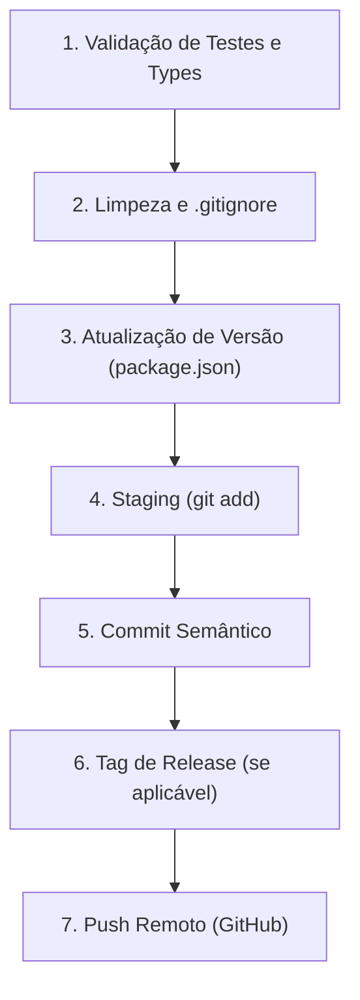

# Git Semantic Workflow & Release Skill

Esta skill define o protocolo oficial e automatizado para commits, controle de versões (SemVer) e sincronização do repositório **Notes-MD** no GitHub.

## 1. Diretrizes de Versionamento (Fase Alpha Pré-v1.0.0)

> [!IMPORTANT]
> **O projeto está atualmente em fase de desenvolvimento ALPHA.**
> Nenhuma versão de lançamento `1.0.0` deve ser gerada até que o usuário declare formalmente que o aplicativo está pronto para lançamento estável.

- **Formato da Versão**: `0.x.y-alpha.z` (ex: `0.1.0-alpha.1`).
- **Versão no `package.json`**: Sempre sincronizada com o ciclo alpha atual.
- **Regras de incremento (Bump de Versão)**:
  - `alpha patch / fix`: `0.1.0-alpha.1` ➔ `0.1.0-alpha.2` (correções de bugs, ajustes visuais, refatorações menores).
  - `alpha minor / feat`: `0.1.0-alpha.X` ➔ `0.2.0-alpha.1` (novas funcionalidades de destaque, módulos grandes).
  - **Lançamento v1.0.0**: Somente quando aprovado explicitamente pelo usuário.
- **Tags de Release Git**: Tags anotadas no formato `v0.x.y-alpha.z` (ex: `git tag -a v0.1.0-alpha.1 -m "Release v0.1.0-alpha.1: Janelas flexíveis e tema Dracula"`).

---

## 2. Padrão de Semantic Commits (Commitizen / Conventional Commits)

Cada commit deve seguir rigorosamente a especificação do **Conventional Commits 1.0.0** e o padrão de seleção do **Commitizen**:

```
<tipo>(<escopo>): <descrição no imperativo em português>

[corpo detalhado explicando o motivo da mudança, solução técnica e arquivos envolvidos]

[rodapé opcional com notas de release, issues ou BREAKING CHANGE]
```

### Tipos Permitidos:
- **`feat`**: Nova funcionalidade perceptível para o usuário final.
- **`fix`**: Correção de bug ou falha de comportamento.
- **`refactor`**: Reestruturação de código sem alterar funcionalidade ou corrigir bug.
- **`style`**: Ajustes visuais, CSS, formatação, espaçamento (ex: tema Dracula, bordas, drop zones).
- **`perf`**: Otimizações de renderização, memoização, parsing de notas.
- **`test`**: Adição ou ajuste de testes automatizados (Vitest).
- **`docs`**: Atualizações de documentação, README, guias.
- **`build`**: Modificações no build system, Vite, Electron, dependências npm.
- **`chore`**: Tarefas de manutenção, `.gitignore`, configurações gerais.
- **`revert`**: Reversão de commit anterior.

### Regras do Cabeçalho:
1. **Tipo e Escopo**: Em minúsculo e inglês (ex: `feat(editor):`, `fix(workspace):`, `style(theme):`).
2. **Descrição**: Em **Português do Brasil**, no tempo **imperativo presente** (ex: "adicionar", "corrigir", "implementar", "remover").
3. **Sem ponto final** no cabeçalho.
4. **Sem letra maiúscula inicial** na descrição.

### Regras do Corpo:
- Sempre fornecer corpo explicativo para commits relevantes.
- Detalhar o **porquê** da alteração (o problema que existia), **como** foi resolvido, e os componentes afetados.

---

## 3. Checklist Obrigatório de Execução do Agente

Sempre que o usuário pedir para commitar, gerar versão, release ou dar push, siga esta sequência exata:



### Passo 1: Validação de Qualidade
Antes de qualquer commit, valide a integridade do código:
```powershell
npm test
npm run typecheck
```
*Se houver qualquer falha de teste ou tipagem, corrija antes de commitar.*

### Passo 2: Verificação do `.gitignore`
Certifique-se de que nenhum artefato temporário, cache (`*.tsbuildinfo`, `dist/`, `out/`, `.vite/`) ou dados confidenciais estão sendo incluídos.

### Passo 3: Bump de Versão (se for release/marco)
Se a alteração encerra um ciclo de tarefas ou o usuário pediu release:
- Atualize `"version"` no `package.json` para o próximo passo alpha (ex: `0.1.0-alpha.1`).

### Passo 4: Git Staging
```powershell
git add .
```

### Passo 5: Executar Commit
Construa uma mensagem semântica completa e informativa:
```powershell
git commit -m "<tipo>(<escopo>): <descrição>" -m "<corpo detalhado em português>"
```

### Passo 6: Tag de Release (quando aplicável)
```powershell
git tag -a v0.x.y-alpha.z -m "Release v0.x.y-alpha.z: <resumo>"
```

### Passo 7: Enviar para o GitHub
```powershell
git push origin main
git push origin --tags
```
*(Nota: comandos que acessam rede ou gravam no `.git` devem ser executados com BypassSandbox quando necessário).*

---

## 4. Exemplos Práticos de Commits para o Projeto

### Exemplo de `feat`:
```text
feat(workspace): implementar suporte a janelas flexíveis divididas lado a lado e em cascata

- Adiciona componentes EditorWorkspace e EditorPaneView permitindo dividir o editor horizontalmente e verticalmente.
- Implementa redimensionamento de proporção com arraste do divisor e duplo clique para redefinir em 50/50.
- Suporta mover notas entre janelas via drag and drop e barra de guias independente por painel.
- Mantém painéis laterais fixos e área central flexível.
```

### Exemplo de `fix`:
```text
fix(workspace): eliminar overlay preso de drag and drop e fechar janela vazia automaticamente

- Adiciona listeners globais na janela para limpar dropZone no cancelamento ou conclusão de qualquer arraste.
- Restringe zonas de divisão ao corpo do editor para não interferir na barra de abas.
- Implementa fechamento automático e retorno ao modo de janela única quando uma janela perde todas as suas notas.
```

### Exemplo de `style`:
```text
style(theme): aplicar paleta de cores Dracula oficial do VS Code no modo dark

- Configura variáveis de cores oficiais do Dracula (#282a36, #21222c, #343746, #bd93f9, #50fa7b).
- Reduz contraste excessivo nas bordas e superfícies dos painéis.
- Atualiza destaque de blocos de código e diagramas Mermaid.
```
