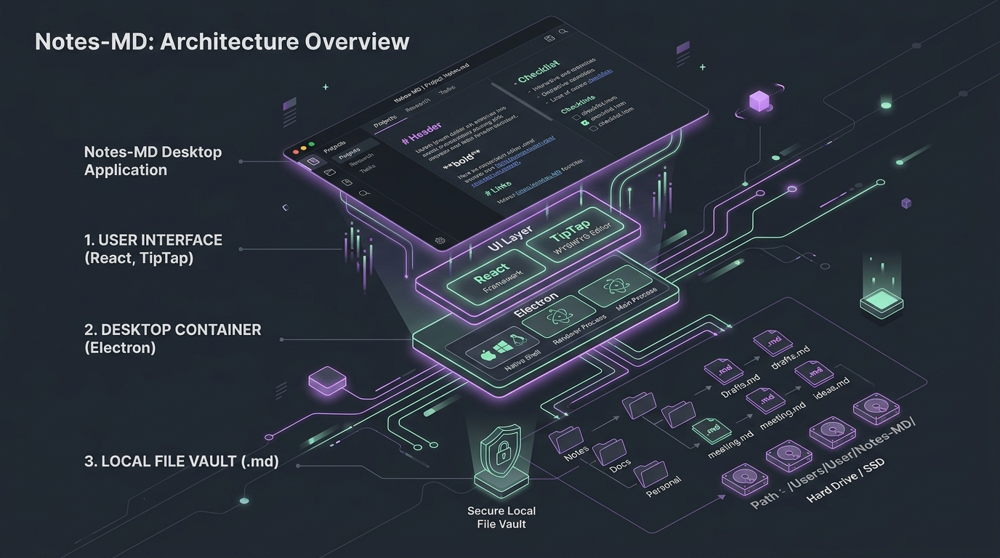

# 🏗️ Arquitetura do App: Como o Notes-MD Funciona por Debaixo dos Panos?

Se você já se perguntou como um aplicativo moderno como o **Notes-MD** consegue ter a aparência fluida de uma página da web e, ao mesmo tempo, acessar com segurança os arquivos do seu computador, este documento é para você!

Aqui explicamos tudo sem termos difíceis, usando comparações simples do dia a dia.

---

## 🎨 Visão Geral da Arquitetura

*Ilustração da separação entre a Interface Visual do usuário e o Motor do Sistema conectado ao seu disco rígido.*

---

## 1. A Analogia do Restaurante: Como o Electron Funciona?

O Notes-MD é construído em cima de uma tecnologia chamada **Electron**. O Electron funciona exatamente como um **Restaurante de Alto Padrão**:

```mermaid
flowchart LR
    subgraph SALAO["🍽️ Salão do Restaurante (Processo Visual / Renderer)"]
        UI["Interface Gráfica (React 18)"]
        EDITOR["Editor de Texto (TipTap WYSIWYG + Markdown)"]
        THEME["Estilos e Temas (Tailwind CSS)"]
        WINDOWS["Janelas Auxiliares (Configurações, Pomodoro, Imagens)"]
    end

    subgraph GARCOM["🤵 Garçom de Confiança (Ponte Segura / Preload API)"]
        IPC["Ponte Protegida (contextBridge)"]
    end

    subgraph COZINHA["👨‍🍳 Cozinha e Despensa (Processo Principal / Main Node.js)"]
        FS["Leitor e Gravador (.md, imagens e áudio MP3)"]
        WATCHER["Sentinela de Mudanças no Disco (Watcher)"]
        SERVICES["Serviços (Pomodoro, Side Notes, Ortografia, Fontes, Discord RPC, Updates)"]
        TRASH["Lixeira do Sistema Operacional"]
    end

    SALAO <-->|"Pedidos e Respostas Seguras"| GARCOM
    GARCOM <-->|"Ações no Sistema"| COZINHA
    COZINHA <-->|"Gravação em Tempo Real"| DISCO[("💾 Seu Disco Rígido (Vault de Notas & .notes-md/audio/)")]
```

1. **O Salão (Processo Visual / Renderer)**:
   - É a parte visível onde você interage. É construída com **React 18** e **Tailwind CSS**, incluindo a janela principal e janelas auxiliares independentes (Configurações, Pomodoro flutuante/relatórios e Visualizador de Imagens).
   - Aqui vivem a digitação, a barra de ferramentas, o gravador e player de áudio, os temas (Dracula, Claro, Sépia) e os menus.
   - **Regra de Segurança**: Por segurança, o salão não tem permissão para mexer diretamente nos arquivos do sistema nem abrir os armários do computador.
2. **A Cozinha (Processo Principal / Main com Node.js)**:
   - Fica nos bastidores do seu computador (`src/main/`).
   - É quem tem a chave do disco rígido para ler e gravar notas `.md`, imagens e áudios em `.notes-md/audio/`, renomear/mover pastas, listar fontes do sistema, gerenciar o Pomodoro e as Observações laterais, executar o corretor ortográfico, conectar ao Discord Rich Presence, verificar atualizações no GitHub Releases (`electron-updater`) e enviar itens excluídos para a lixeira do sistema.
   - Além disso, o módulo `runtimeEnv.ts` isola automaticamente o perfil (`userData`) e o cofre padrão do modo desenvolvimento (`npm run dev`) para não interferir na versão estável instalada.
3. **O Garçom de Confiança (Preload & ContextBridge)**:
   - É a ponte segura (`src/preload/`) que conecta o Salão à Cozinha via `window.electronAPI`.
   - Quando você salva uma nota, grava um áudio ou altera configurações, a interface envia um pedido específico ao Garçom, que repassa à Cozinha e devolve o resultado com segurança máxima.

---

## 2. Soberania de Dados: Suas Notas são 100% Suas

Ao contrário de serviços baseados na nuvem (como Notion, Evernote ou Google Docs), o Notes-MD adota a filosofia **Local-First (Primeiro no seu computador)**:

- **Arquivos `.md` puros**: cada anotação é um arquivo de texto comum na pasta que você escolher (seu *Vault*).
- **Sem bancos de dados proprietários**: se amanhã você desinstalar o Notes-MD, você pode abrir suas notas no Bloco de Notas, no VS Code, no Obsidian ou em qualquer outro programa.
- **Funciona 100% Offline**: o Notes-MD não precisa de internet para abrir, pesquisar ou editar suas anotações.
- **Sincronização ao seu critério**: como as notas são arquivos normais, você pode sincronizá-las usando Dropbox, Google Drive, OneDrive, Git/GitHub ou mantê-las apenas no seu HD.

---

## 3. O Sentinela em Tempo Real (File Watcher)

E se você editar um arquivo `.md` por fora (por exemplo, no Bloco de Notas ou através do Git)?

O Notes-MD possui um **Sentinela do Sistema de Arquivos** ativo na Cozinha (Main process). Sempre que um arquivo dentro do seu cofre é criado, modificado ou apagado externamente, o sentinela avisa a interface no mesmo instante para atualizar a árvore de pastas e o conteúdo na tela sem precisar recarregar o programa!

---

## 4. Exclusão Segura: Nada de Deletar para Sempre!

No Notes-MD, quando você exclui uma nota ou pasta pelo explorador lateral, o aplicativo **nunca apaga os arquivos de forma destrutiva**:

- Ele solicita a confirmação do usuário.
- O arquivo é enviado diretamente para a **Lixeira do Sistema Operacional** (através da API nativa do Electron `shell.trashItem`).
- Se você se arrepender, basta abrir a Lixeira do Windows/Mac e restaurar o arquivo normalmente.

---

## 5. Resumo das Tecnologias Usadas

| Tecnologia | O que faz no app? | Por que foi escolhida? |
| :--- | :--- | :--- |
| **Electron 31** | Transforma o código web em aplicativo desktop (`.exe` / app) | Integração nativa com janelas, lixeira do sistema, fontes, ortografia e disco local. |
| **electron-vite** | Compila e empacota Main, Preload e Renderer com Hot Reload | Desenvolvimento rápido com separação clara entre Node.js e interface web. |
| **React 18** | Constrói os componentes da tela de forma reativa | Atualiza instantaneamente a interface quando os dados mudam. |
| **TypeScript 5.5** | Garante que o código não tenha erros de tipo | Traz segurança, previsibilidade e menos bugs na aplicação. |
| **Tailwind CSS** | Estiliza todo o visual com tokens semânticos | Permite alternar temas (Dracula, Claro, Sépia) e cores de destaque com facilidade. |
| **TipTap + tiptap-markdown** | Motor do editor WYSIWYG e conversão para Markdown | Permite editar texto rico e converter bidirecionalmente para `.md` limpo. |
| **Mermaid.js & Lowlight** | Diagramas visuais e realce sintático em blocos de código | Renderiza fluxogramas e códigos multilinguagem diretamente dentro das notas. |
| **wasm-media-encoders** | Codifica gravações de microfone para MP3 em WebAssembly | Mantém áudios compactos e portáteis dentro do cofre sem depender de servidor externo. |
| **Vitest** | Executa testes automatizados de serviços e lógica do editor | Garante estabilidade contínua em indexação, sessões, atalhos e regras do editor. |
