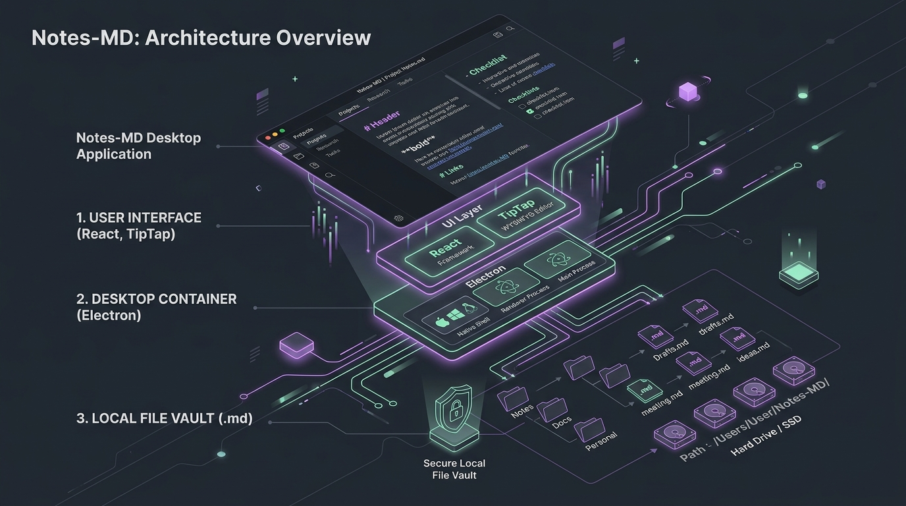

# 🏗️ Arquitetura do App: Como o Notes-MD Funciona por Debaixo dos Panos?

Se você já se perguntou como um aplicativo moderno como o **Notes-MD** consegue ter a aparência fluida de uma página da web e, ao mesmo tempo, acessar com segurança os arquivos do seu computador, este documento é para você!

Aqui explicamos tudo sem termos difíceis, usando comparações simples do dia a dia.

---

## 🎨 Visão Geral da Arquitetura

*Ilustração da separação entre a Interface Visual do usuário e o Motor do Sistema conectado ao seu disco rígido.*

---

## 1. A Analogia do Restaurante: Como o Electron Funciona?

O Notes-MD é construído em cima de uma tecnologia chamada **Electron**. O Electron funciona exatamente como um **Restaurante de Alto Padrão**:

```mermaid
flowchart LR
    subgraph SALAO["🍽️ Salão do Restaurante (Processo Visual / Renderer)"]
        UI["Interface Gráfica (React)"]
        EDITOR["Editor de Texto (TipTap WYSIWYG)"]
        THEME["Estilos e Temas (Tailwind CSS)"]
    end

    subgraph GARCOM["🤵 Garçom de Confiança (Ponte Segura / Preload API)"]
        IPC["Ponte Protegida (contextBridge)"]
    end

    subgraph COZINHA["👨‍🍳 Cozinha e Despensa (Processo Principal / Main Node.js)"]
        FS["Leitor e Gravador de Arquivos (.md)"]
        WATCHER["Sentinela de Mudanças no Disco (Watcher)"]
        TRASH["Lixeira do Sistema Operacional"]
    end

    SALAO <-->|"Pedidos e Respostas Seguras"| GARCOM
    GARCOM <-->|"Ações no Sistema"| COZINHA
    COZINHA <-->|"Gravação em Tempo Real"| DISCO[("💾 Seu Disco Rígido (Vault de Notas)")]
```

1. **O Salão (Processo Visual / Renderer)**:
   - É a parte bonita onde o cliente (você) senta e interage. É feito com **React** e **Tailwind CSS**.
   - Aqui vive a digitação, os botões bonitos, as cores do tema Dracula e os menus.
   - **Regra de Segurança**: Por segurança, o salão não tem permissão para mexer diretamente nas facas da cozinha nem abrir os armários do computador.
2. **A Cozinha (Processo Principal / Main com Node.js)**:
   - Fica nos bastidores do seu computador.
   - É quem tem a chave do seu disco rígido para ler arquivos `.md`, salvar alterações, renomear pastas e enviar itens para a lixeira do Windows/Mac/Linux.
3. **O Garçom de Confiança (Preload & ContextBridge)**:
   - É a ponte que conecta o Salão à Cozinha.
   - Quando você clica em *"Salvar"* ou abre uma nota, a interface chama o Garçom com um pedido específico. O Garçom leva o pedido à Cozinha, que executa e devolve o resultado com segurança máxima.

---

## 2. Soberania de Dados: Suas Notas são 100% Suas

Ao contrário de serviços baseados na nuvem (como Notion, Evernote ou Google Docs), o Notes-MD adota a filosofia **Local-First (Primeiro no seu computador)**:

- **Arquivos `.md` puros**: cada anotação é um arquivo de texto comum na pasta que você escolher (seu *Vault*).
- **Sem bancos de dados proprietários**: se amanhã você desinstalar o Notes-MD, você pode abrir suas notas no Bloco de Notas, no VS Code, no Obsidian ou em qualquer outro programa.
- **Funciona 100% Offline**: o Notes-MD não precisa de internet para abrir, pesquisar ou editar suas anotações.
- **Sincronização ao seu critério**: como as notas são arquivos normais, você pode sincronizá-las usando Dropbox, Google Drive, OneDrive, Git/GitHub ou mantê-las apenas no seu HD.

---

## 3. O Sentinela em Tempo Real (File Watcher)

E se você editar um arquivo `.md` por fora (por exemplo, no Bloco de Notas ou através do Git)?

O Notes-MD possui um **Sentinela do Sistema de Arquivos** ativo na Cozinha (Main process). Sempre que um arquivo dentro do seu cofre é criado, modificado ou apagado externamente, o sentinela avisa a interface no mesmo instante para atualizar a árvore de pastas e o conteúdo na tela sem precisar recarregar o programa!

---

## 4. Exclusão Segura: Nada de Deletar para Sempre!

No Notes-MD, quando você exclui uma nota ou pasta pelo explorador lateral, o aplicativo **nunca apaga os arquivos de forma destrutiva**:

- Ele solicita a confirmação do usuário.
- O arquivo é enviado diretamente para a **Lixeira do Sistema Operacional** (através da API nativa do Electron `shell.trashItem`).
- Se você se arrepender, basta abrir a Lixeira do Windows/Mac e restaurar o arquivo normalmente.

---

## 5. Resumo das Tecnologias Usadas

| Tecnologia | O que faz no app? | Por que foi escolhida? |
| :--- | :--- | :--- |
| **Electron** | Transforma o código web em aplicativo desktop (.exe / app) | Integração nativa com janelas, menus de contexto e disco local. |
| **React 18** | Constrói os componentes da tela de forma reativa | Atualiza instantaneamente a interface quando os dados mudam. |
| **TypeScript** | Garante que o código não tenha erros de tipo | Traz segurança, previsibilidade e menos bugs na aplicação. |
| **Tailwind CSS** | Estiliza todo o visual com classes utilitárias | Permite alternar temas (Dracula, Claro, Sépia) com extrema facilidade. |
| **TipTap** | Motor do editor de texto WYSIWYG | Permite formatar texto rico e converter para Markdown puro sem falhas. |
