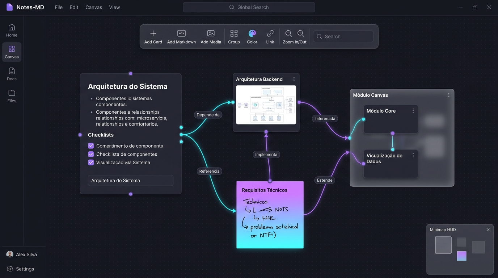
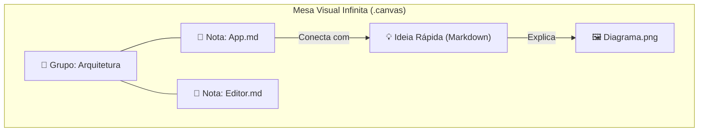
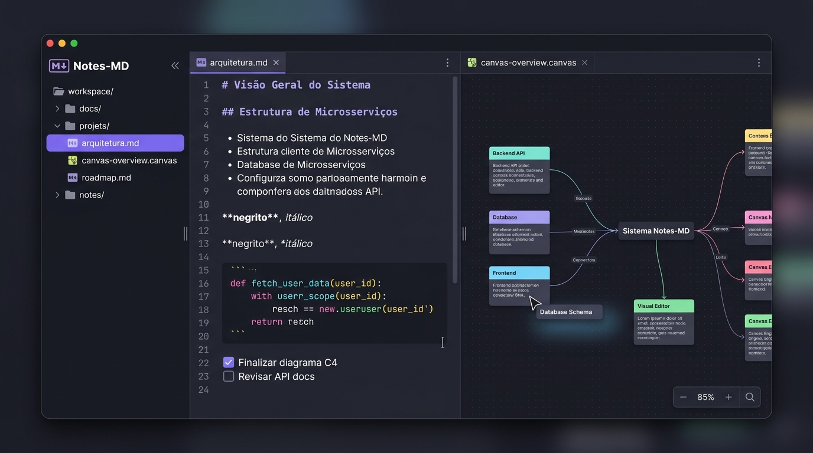
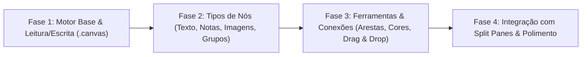

# 🎨 Arquitetura do Canvas Infinito — Notes-MD

Este documento detalha o planejamento arquitetural, a especificação técnica e as opções de implementação para o recurso de **Canvas Visual Infinito** no **Notes-MD**, seguindo o mesmo padrão aberto do **Obsidian Canvas (`.canvas`)**.

---

## 🌟 1. O que é o Canvas Infinito?

O Canvas Infinito é uma mesa de trabalho visual bidimensional sem limites físicos onde o usuário pode organizar ideias espacialmente, criar mapas mentais, fluxogramas, painéis de humor (*moodboards*) e conectar anotações, imagens e links através de setas e grupos.

Enquanto as notas tradicionais (`.md`) organizam o pensamento de forma **linear** (de cima para baixo), o Canvas permite organizar o conhecimento de forma **relacional e espacial** (lado a lado, agrupado, interconectado).


*Figura 1: Representação conceitual da interface do Canvas Infinito no Notes-MD com cartões de notas, imagens, grupos com moldura translúcida e conectores dinâmicos sobre grid pontilhado no tema Dracula.*



---

## 📄 2. Compatibilidade Total com o Formato Oficial `.canvas` (JSON Canvas)

O Obsidian Canvas utiliza uma especificação aberta chamada [JSON Canvas 1.0 (jsoncanvas.org)](https://jsoncanvas.org/).

No Notes-MD, **adotaremos rigorosamente essa mesma especificação**. Isso significa que:
1. Qualquer arquivo `.canvas` criado no Obsidian abrirá perfeitamente no Notes-MD.
2. Qualquer canvas criado no Notes-MD funcionará no Obsidian sem conversão ou perda de dados.
3. Não há banco de dados proprietário: é um arquivo `.canvas` (JSON limpo e legível) salvo diretamente no Vault do usuário.

### Estrutura de Dados Oficial

```json
{
  "nodes": [
    {
      "id": "a1b2c3d4e5f67890",
      "type": "text",
      "text": "# Ideia Central\nTexto em **Markdown** com suporte a [[WikiLinks]].",
      "x": 100,
      "y": 150,
      "width": 300,
      "height": 200,
      "color": "4"
    },
    {
      "id": "b2c3d4e5f67890a1",
      "type": "file",
      "file": "Projetos/App.md",
      "x": 500,
      "y": 150,
      "width": 320,
      "height": 280
    }
  ],
  "edges": [
    {
      "id": "edge1234567890ab",
      "fromNode": "a1b2c3d4e5f67890",
      "fromSide": "right",
      "toNode": "b2c3d4e5f67890a1",
      "toSide": "left",
      "toEnd": "arrow",
      "label": "Implementa",
      "color": "4"
    }
  ]
}
```

---

## 🧩 3. Tipos de Nós Suportados

| Tipo de Nó | Descrição | Comportamento no Notes-MD |
| :--- | :--- | :--- |
| **`text`** | Cartão de anotação rápida em Markdown | Edição in-place com realce Markdown, WikiLinks e renderização rica. |
| **`file`** | Nota (`.md`) ou imagem do cofre | Exibe o conteúdo real do arquivo com botão de navegação rápida e preview sincronizado. |
| **`link`** | Link web externo | Cartão com título da página, URL, favicon e botão para abrir no navegador padrão. |
| **`group`** | Caixa visual de agrupamento | Moldura com título no cabeçalho e cor de fundo translúcida para delimitar seções. |

### Conexões (Edges):
- Saída e entrada em qualquer um dos 4 lados de um nó (`top`, `right`, `bottom`, `left`).
- Formatos de ponta: `arrow` (seta direcional) ou `none` (linha neutra).
- Rótulos textuais opcionais posicionados no centro da aresta.
- Curvas suaves de Bézier com prevenção inteligente de colisão.

---

## ⚖️ 4. Comparativo de Tecnologias de Implementação

Para implementar o Canvas na stack **React 18 + Vite + TypeScript**, três abordagens foram analisadas:

### Opção A: `@xyflow/react` (React Flow 12) — ⭐ **RECOMENDADA**
- **Vantagens**:
  - A biblioteca de grafos interativos e fluxogramas mais sólida e madura do ecossistema React (+27k estrelas no GitHub).
  - Suporte nativo e otimizado a **zoom infinito (wheel)**, **pan suave**, **minimapa**, **seleção múltipla em caixa (*marquee selection*)**, **snap-to-grid**, e atalhos de navegação.
  - Arquitetura 100% modular com **Nós Customizados (*Custom Nodes*)**: cada nó é simplesmente um componente React, permitindo colocar o editor de Markdown, cards com botões e imagens com preview nativo.
  - Mapeamento direto de 1 para 1 com a estrutura JSON Canvas do Obsidian.
- **Desvantagens**:
  - Adição de uma dependência externa (~150 KB gzip), porém muito performática e com licença MIT.

### Opção B: `@tldraw/tldraw`
- **Vantagens**: Excelente para quadros brancos de desenho à mão livre (caneta, lápis, formas livres).
- **Desvantagens**: Pacote pesado (+2 MB); estrutura interna orientada a vetores livres e shapes, tornando a conversão para o formato JSON Canvas rígido de nós e arestas complexa e propensa a perda de fidelidade.

### Opção C: Motor Próprio em SVG / HTML5 Canvas do Zero
- **Vantagens**: Zero dependências adicionais.
- **Desvantagens**: Reinventar a roda em cálculo de matriz de transformação de viewport (zoom/pan), conexões ortogonais/Bézier, detecção de ancoragem de conectores, atalhos de seleção em área e minimapa. Exigiria semanas de desenvolvimento e alto risco de regressão.

> [!TIP]
> **Conclusão Técnica**: A **Opção A (`@xyflow/react`)** é a solução ideal por ser rápida, extensível, manter o padrão de componentes React do projeto e garantir paridade total com o Obsidian Canvas.

---

## 🏗️ 5. Integração com a Arquitetura do Notes-MD

### 1. Sistema de Arquivos (IPC & Vault)
- Adição dos métodos IPC no processo principal (`src/main/vaultService.ts` e `src/preload`):
  - `readCanvas(vaultPath, relPath): Promise<CanvasData>`
  - `writeCanvas(vaultPath, relPath, data: CanvasData): Promise<void>`
  - `createCanvas(vaultPath, folderRelPath, title): Promise<VaultFileEntry>`
- No Explorador de Arquivos (`FileExplorerSidebar.tsx`):
  - Arquivos com extensão `.canvas` recebem ícone temático (`Workflow`) e tag colorida `CANVAS` em roxo/violeta.
  - Opção no menu de contexto de pastas: **"Novo Canvas"**.

### 2. Split Panes e Abas
- Como o Notes-MD suporta divisão flexível de janelas (`EditorWorkspace` e `EditorPaneView`), uma aba de nota pode ser aberta **lado a lado com uma aba de Canvas**.
- O usuário pode visualizar a nota à esquerda e organizá-la visualmente no Canvas à direita.


*Figura 2: Vista em Split Panes permitindo editar uma anotação Markdown no painel esquerdo enquanto mapeia visualmente as conexões e interage com o Canvas no painel direito.*

### 3. Drag and Drop Nativo
- Arrastar uma nota `.md` ou uma imagem do Explorador de Arquivos e soltar sobre o Canvas cria automaticamente um nó do tipo `file` nas coordenadas exatas do cursor do mouse!

---

## 🗺️ 6. Fases de Implementação Planejadas



1. **Fase 1: Infraestrutura e Formato de Dados**
   - Criação dos tipos TypeScript para a especificação JSON Canvas (`src/renderer/src/types/canvas.ts`).
   - Métodos IPC de leitura, escrita e criação de arquivos `.canvas`.
   - Adição do pacote `@xyflow/react`.

2. **Fase 2: Componentes de Nós e Renderização**
   - Criação de `TextNode` (com edição Markdown).
   - Criação de `FileNode` (com leitura do conteúdo da nota e preview de imagem).
   - Criação de `GroupNode` (com moldura translúcida e etiqueta).

3. **Fase 3: Barra de Ferramentas e Conexões**
   - Conector interativo entre nós (puxar seta e soltar no nó destino).
   - Paleta de cores oficial (vermelho, laranja, amarelo, verde, ciano, roxo).
   - Arraste de notas da barra lateral para criar nós automaticamente no canvas.

4. **Fase 4: Split Panes e Recursos Avançados**
   - Abertura de Canvas em abas divididas.
   - Minimapa interativo e atalhos de teclado (<kbd>Espaço + Arrastar</kbd> para Pan, <kbd>Ctrl + Roda</kbd> para Zoom).
