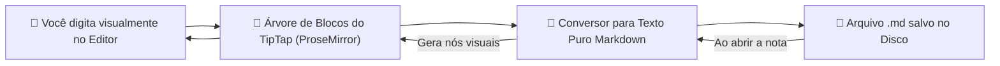
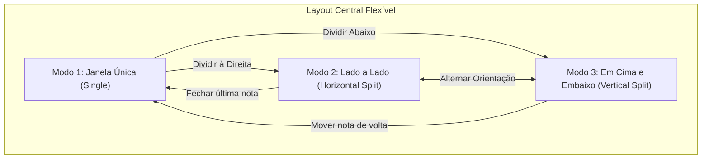
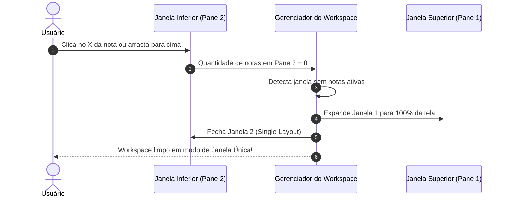

# ✍️ Como Funciona o Editor e as Janelas Flexíveis (Split Panes)?

Editar anotações não deveria ser difícil. Tradicionalmente, muitos editores Markdown obrigam você a escrever códigos com símbolos e abrir uma segunda janela para ver como o texto ficou. No **Notes-MD**, você tem o melhor dos dois mundos em uma experiência única.

Neste capítulo, explicamos de forma visual como funciona o motor de edição e a engenharia das janelas divididas.

---

## 1. O que é WYSIWYG e Como Ele Funciona?

A sigla **WYSIWYG** significa *"What You See Is What You Get"* (O que você vê é o que você tem). 

Quando você seleciona uma palavra e aperta o botão de **Negrito** ou <kbd>Ctrl+B</kbd>, você não vê `**palavra**`, você vê a **palavra em negrito na mesma hora**, exatamente como no Microsoft Word ou no Notion.

### O Motor por Trás: TipTap & ProseMirror
O Notes-MD usa o **TipTap**, uma biblioteca moderna construída sobre o **ProseMirror** (o mesmo motor utilizado por ferramentas como o editor do Jira, Confluence e The New York Times).
- Em vez de tratar o texto como uma simples sequência de caracteres, o TipTap entende o texto como uma **árvore de blocos**: um título é um bloco, uma tabela é um bloco com linhas e células, e um checklist é uma lista de itens com estado marcado/desmarcado.
- Quando você salva a nota, o conversor percorre essa árvore e transforma tudo em Markdown limpo e padronizado.

---

## 2. A Mágica das Janelas Flexíveis (Split Panes)

Inspirado em ambientes de desenvolvimento profissionais como o **Visual Studio Code**, o Notes-MD permite dividir a área central do aplicativo em duas janelas simultâneas:

### As Duas Regiões do Aplicativo:
1. **Regiões Fixas**:
   - A barra lateral esquerda (Explorador de Arquivos) e a barra lateral direita (Backlinks e Sumário) são áreas fixas de apoio. Elas podem ser recolhidas ou redimensionadas, mas notas não se transformam em janelas dentro delas.
2. **Região Central Flexível**:
   - É a área onde o editor vive. Ela pode ser uma janela única ou se dividir em dois painéis independentes (`pane-1` e `pane-2`).

---

## 3. Como Funciona o Arraste de Janelas (Drag and Drop)?

Você pode mover notas entre painéis de duas formas:
1. **Pela Barra de Abas**: Arraste a aba de uma nota e solte-a na barra de abas da outra janela para transferi-la.
2. **Pelo Corpo do Editor (Zonas de Divisão)**:
   - Ao arrastar uma aba sobre o corpo do editor, o aplicativo calcula a posição do seu cursor em relação às quatro bordas da tela:
     - **Borda Direita (últimos 25% da largura)**: ativa o indicador *"Dividir à Direita"*.
     - **Borda Esquerda (primeiros 25% da largura)**: ativa o indicador *"Dividir à Esquerda"*.
     - **Borda Inferior (últimos 25% da altura)**: ativa o indicador *"Dividir Abaixo"*.
     - **Borda Superior (primeiros 25% da altura)**: ativa o indicador *"Dividir Acima"*.
     - **Centro da Tela**: move a nota para a janela atual sem criar nova divisão.

### Como Evitamos Caixas Verdes Presas na Tela?
Um desafio comum em interfaces complexas de arrastar e soltar é a caixa verde pontilhada ficar "presa" na tela se o usuário soltar o botão do mouse fora do lugar certo ou apertar <kbd>Esc</kbd>.

No Notes-MD, implementamos sentinelas globais na janela principal:
- Se o arraste for cancelado, a tecla <kbd>Esc</kbd> for pressionada, ou o mouse for solto em qualquer parte da tela, o indicador é imediatamente destruído.
- A barra de abas agora tem proteção própria: passar o mouse sobre as abas cancela imediatamente qualquer divisão do corpo do editor, garantindo uma transição visual perfeita.

---

## 4. Fechamento Automático Inteligente

O que acontece quando você tem duas janelas abertas e fecha a única nota que estava na janela de baixo?

Em muitos programas, você ficaria com uma janela vazia inútil ocupando metade da tela. No **Notes-MD**, o sistema detecta que aquela área ficou com 0 notas e **fecha a janela automaticamente**:

Esse mesmo comportamento se aplica se você mover a única nota de uma janela para a outra: a janela de origem se recolhe suavemente, deixando você com foco total no seu texto.
