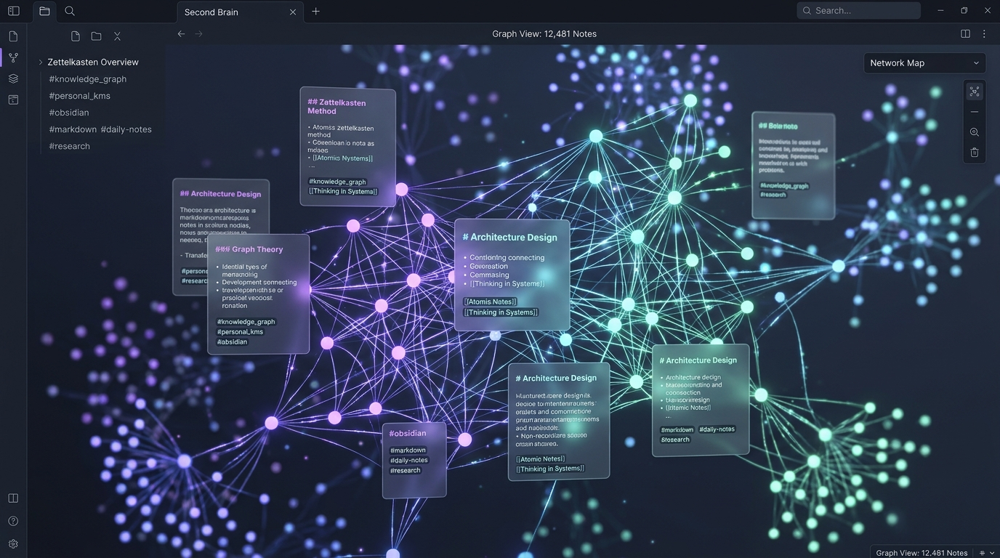
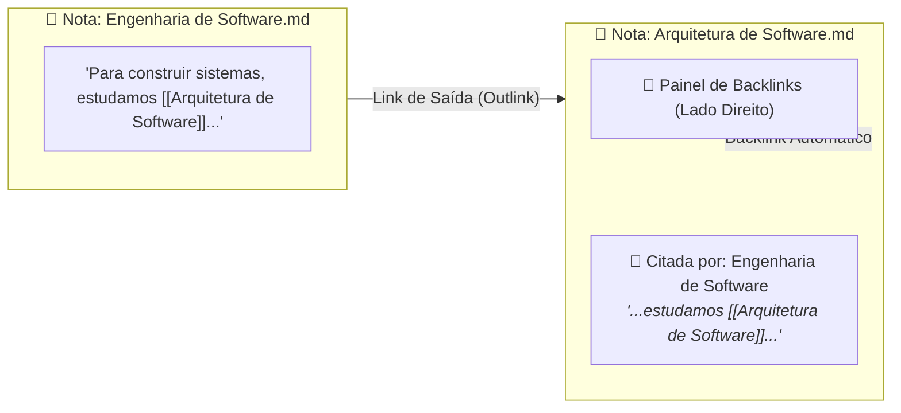
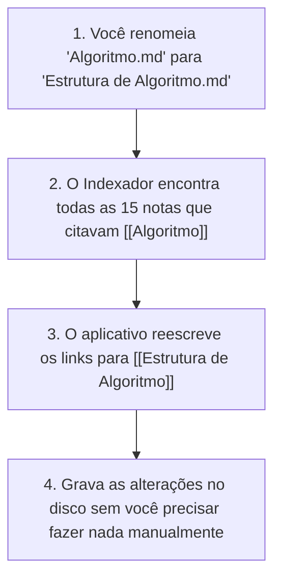

# 🧠 Conexões de Notas e Conhecimento em Rede: O Segundo Cérebro

Em um bloco de notas tradicional, seus pensamentos ficam isolados em gavetas separadas. No **Notes-MD**, suas anotações funcionam como os neurônios do cérebro humano: **elas conversam entre si**.

Este documento explica como funciona a tecnologia de conexões bidirecionais (estilo Obsidian e método Zettelkasten).

---

## 🌌 O Grafo de Conexões Visuais

<div align="center">


*Visualização conceitual do grafo de conhecimento: cada nó é uma nota e cada raio luminoso é um `[[WikiLink]]` conectando ideias.*

</div>

---

## 1. O que é um WikiLink?

Um **WikiLink** é uma ligação rápida entre duas notas, escrita com colchetes duplos:

```markdown
O conceito de [[Inteligência Artificial]] depende diretamente da [[Lógica de Programação]].
```

No editor visual do Notes-MD, em vez de ver colchetes feios, esse texto vira uma **etiqueta elegante e clicável**:
- Clicar no link com o botão esquerdo abre a nota correspondente.
- Clicar com o botão do meio da rodinha do mouse abre a nota em uma nova guia.
- **Se a nota ainda não existir**: o Notes-MD cria o arquivo `.md` no cofre instantaneamente e abre o editor pronto para você escrever.

---

## 2. A Mão Dupla: O que são Backlinks?

A maior inovação do método Zettelkasten é que os links não são apenas de ida: eles são de **ida e volta**.



- Quando você abre a nota **"Arquitetura de Software"**, você não precisa se lembrar de onde ela foi citada.
- O painel lateral direito lista automaticamente todas as notas do seu cofre que mencionam essa nota, incluindo o **trecho exato** do parágrafo onde o link foi feito.

---

## 3. O Indexador em Memória (`noteIndexer`): Rápido e Sem Internet

Como o Notes-MD descobre todos esses links sem um banco de dados pesado na nuvem?

O segredo é um motor interno chamado **Indexador de Notas**:
1. Quando você abre o aplicativo, ele faz uma leitura rápida de todos os arquivos `.md` do seu cofre em milissegundos.
2. Ele encontra todos os `[[links]]`, todos os títulos (`#`, `##`, `###`) e gera uma tabela de conexões na memória do computador.
3. Se você salvar uma nota nova, o indexador recalcula apenas aquela nota em frações de segundo, sem deixar o aplicativo lento.

---

## 4. O "Olhar Rápido": Pré-visualização com `Ctrl + Hover`

Quantas vezes você estava escrevendo uma ideia, viu um link para outra nota e quis lembrar o que estava escrito nela, mas ficou com preguiça de sair da página atual?

No Notes-MD:
- Segure a tecla <kbd>Ctrl</kbd> e passe o ponteiro do mouse sobre qualquer `[[WikiLink]]`.
- Uma janela flutuante se abre na hora, exibindo o conteúdo formatado daquela nota.
- Ao soltar o <kbd>Ctrl</kbd> ou mover o mouse para longe, a janela desaparece, e você continua escrevendo seu raciocínio sem interrupções!

---

## 5. Renomeação em Cascata: Diga Adeus a Links Quebrados!

Na internet tradicional, se alguém muda o endereço de uma página, o link quebra (`Erro 404`).

No Notes-MD, isso **nunca acontece**:



Você pode reorganizar suas pastas, renomear arquivos e reestruturar suas ideias à vontade: o seu grafo de conexões se mantém sempre vivo, intacto e sincronizado!
